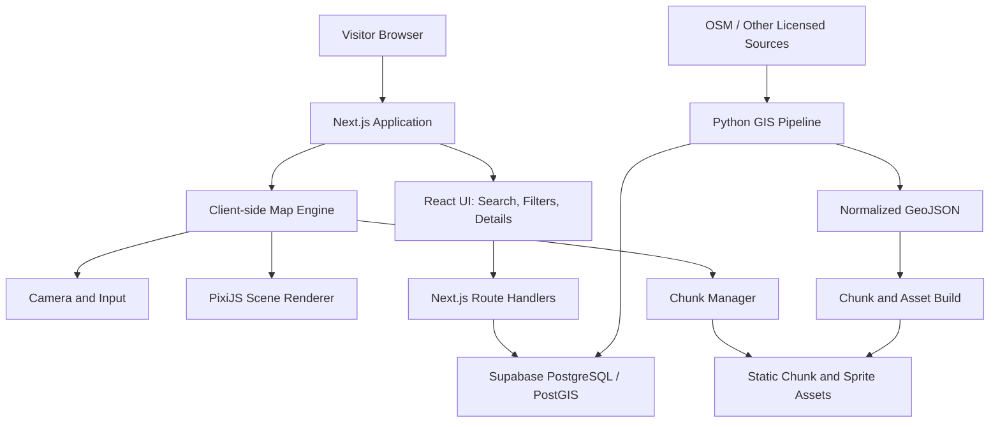

# System Architecture

## 1. Architecture principles

- Keep the Next.js interface separate from the PixiJS rendering engine.
- Treat geographic source data and pixel-art presentation assets as separate layers.
- Load map chunks on demand.
- Keep source coordinates and transformations reproducible.
- Avoid coupling the renderer directly to Supabase.
- Make the first release simple; introduce complexity only when profiling or product needs justify it.

## 2. High-level architecture



## 3. Application layers

### Presentation layer
Next.js App Router and React components:
- `MapCanvas`
- `MapControls`
- `SearchBar`
- `CategoryFilters`
- `LocationPopup`
- `LocationSidebar`
- `LoadingOverlay`

### Map engine
A client-only module responsible for:
- PixiJS application lifecycle.
- Scene and layer management.
- Camera transform and zoom limits.
- Pointer and touch input.
- Coordinate conversion.
- Object hit testing.
- Chunk visibility and loading.
- Depth ordering and level of detail.

### Data access layer
A small service layer reads:
- Location search results.
- Landmark metadata.
- Neighbourhood information.
- Chunk manifest and asset URLs.

The renderer should receive typed data and should not issue SQL or call Supabase directly.

### Geographic processing layer
Python scripts:
1. Acquire source extracts.
2. Clip to the approved boundary.
3. Normalize feature tags and geometry.
4. Validate and repair geometries where possible.
5. Reproject to a suitable local projected CRS for metric operations.
6. Generate chunk indexes and intermediate map geometry.
7. Export reproducible assets and metadata.

## 4. Suggested source structure

```text
pixel-kolkata/
├── public/
│   ├── assets/
│   │   ├── tiles/
│   │   ├── buildings/
│   │   ├── landmarks/
│   │   └── atlases/
│   └── maps/
│       ├── manifest.json
│       └── chunks/
├── scripts/
│   ├── acquire-data.py
│   ├── process-geojson.py
│   ├── generate-chunks.py
│   └── validate-map.py
├── src/
│   ├── app/
│   │   ├── api/
│   │   │   ├── locations/route.ts
│   │   │   └── chunks/[id]/route.ts
│   │   ├── layout.tsx
│   │   └── page.tsx
│   ├── components/
│   │   ├── map/
│   │   ├── search/
│   │   ├── sidebar/
│   │   └── ui/
│   ├── engine/
│   │   ├── core/
│   │   ├── camera/
│   │   ├── renderer/
│   │   ├── chunks/
│   │   ├── interaction/
│   │   └── utils/
│   ├── lib/
│   │   ├── location-service.ts
│   │   └── supabase.ts
│   └── types/
├── database/
│   └── schema.sql
├── docs/
├── CONTRIBUTING.md
└── README.md
```

## 5. Isometric coordinate model

For a diamond grid with tile width `W` and tile height `H`:

```ts
export function toIsometric(x: number, y: number, W = 32, H = 16) {
  return {
    x: (x - y) * (W / 2),
    y: (x + y) * (H / 2),
  };
}

export function fromIsometric(screenX: number, screenY: number, W = 32, H = 16) {
  return {
    x: screenX / W + screenY / H,
    y: screenY / H - screenX / W,
  };
}
```

These functions convert grid coordinates to local isometric coordinates and back. Camera translation, zoom and device-pixel ratio are separate transforms and must be accounted for when converting pointer positions.

## 6. Geographic-to-art transformation

Do not assume longitude/latitude can be used directly as isometric tile coordinates.

Recommended process:
1. Preserve original longitude/latitude.
2. Reproject geometry into a suitable local metric CRS for distance and grid operations.
3. Normalize or simplify geometry according to feature type and zoom level.
4. Map projected coordinates into a chosen city grid.
5. Apply the isometric presentation transform.
6. Store the transformation parameters with each map-data release.

The art may stylize distances and building footprints. Keep the underlying geographic coordinates available for search and metadata.

## 7. Chunking and rendering

Use a configurable chunk grid. A proposed prototype can start with 256 × 256 logical cells per chunk, but benchmark memory and draw cost before adopting it for production.

Each chunk should include:
- Stable chunk ID and grid coordinates.
- Bounding box in the source projected CRS.
- Asset URL(s).
- Data/schema version.
- Optional feature index for hit testing.
- Optional low-detail representation.

Chunk manager responsibilities:
- Determine visible chunks from camera bounds.
- Request visible chunks and a small preload margin.
- Deduplicate in-flight requests.
- Cache recently used chunks.
- Evict distant chunks under a memory budget.
- Cancel or ignore stale requests after rapid camera movement.

## 8. Suggested database model

### `locations`
- `id` UUID primary key
- `name` text
- `slug` text unique
- `category_id` UUID
- `description` text nullable
- `geom` geography(Point, 4326)
- `neighborhood_id` UUID nullable
- `sprite_id` text nullable
- `source` text
- `source_id` text nullable
- `verified_at` timestamptz nullable
- `created_at` timestamptz

### `categories`
- `id` UUID primary key
- `name` text unique
- `icon` text nullable

### `neighborhoods`
- `id` UUID primary key
- `name` text
- `slug` text unique
- `boundary` geometry(MultiPolygon, 4326)

### `map_chunks`
- `id` text primary key
- `grid_x` integer
- `grid_y` integer
- `bounds` geometry(Polygon, 4326)
- `asset_path` text
- `data_version` text

Create spatial indexes for geometry columns. Apply Row Level Security and expose only public read access to published records. Keep service-role credentials on the server.

## 9. API design

Proposed read endpoints:
- `GET /api/locations?query=...&category=...`
- `GET /api/locations/:slug`
- `GET /api/chunks/:id`
- `GET /api/neighborhoods`

Validate and cap query parameters. Add pagination to search. Static chunk assets can be served directly from object storage/CDN rather than proxied through Next.js.

## 10. Security and operations

- Never expose Supabase service-role keys in browser code.
- Validate all route parameters.
- Rate-limit public search endpoints where appropriate.
- Use immutable, versioned asset paths for cache safety.
- Record source dataset version and processing date.
- Monitor client errors, failed chunk loads and API latency.
- Provide a privacy notice if analytics or location features are introduced.
